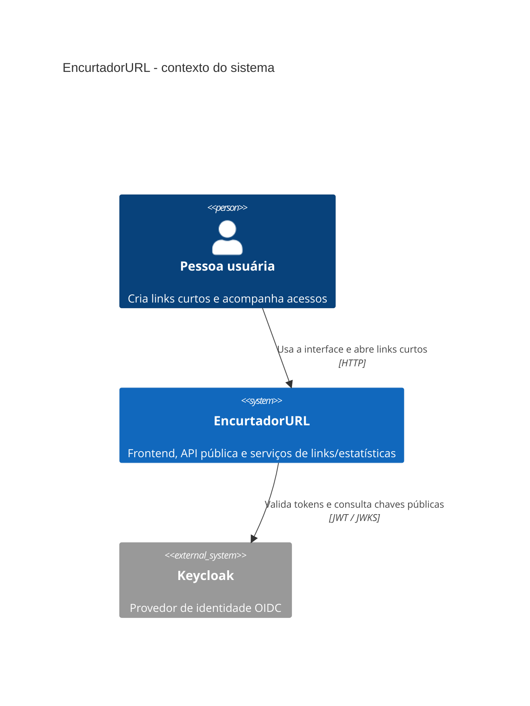
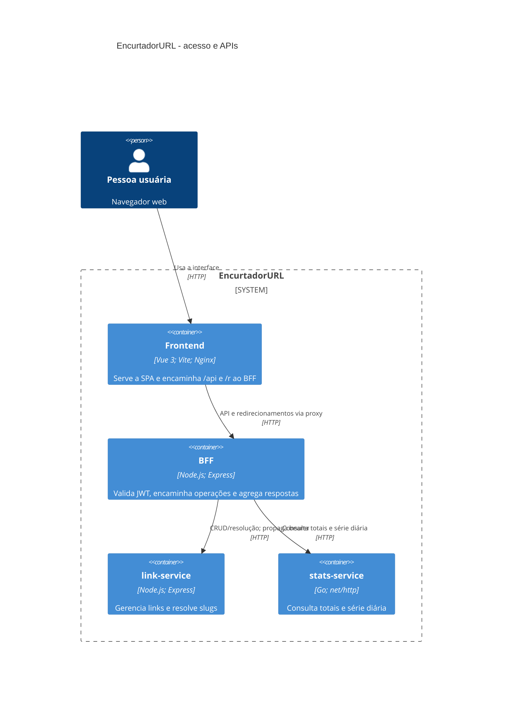
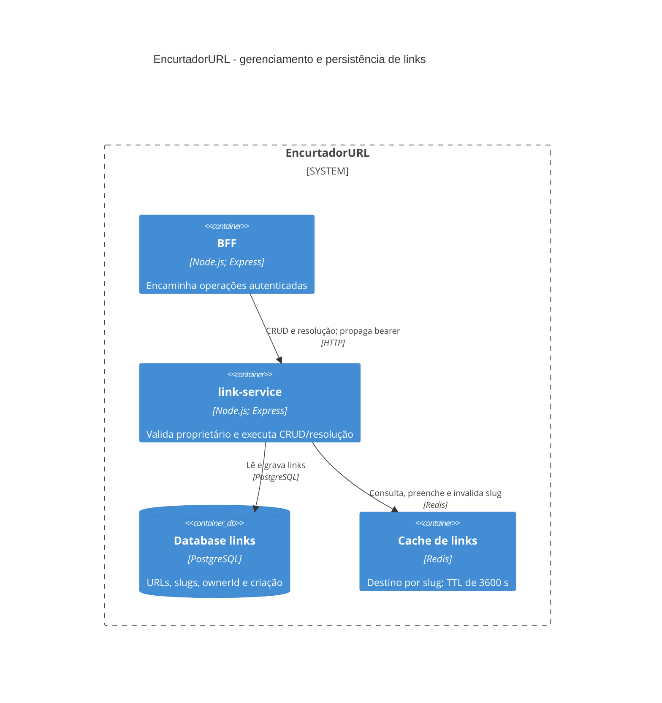
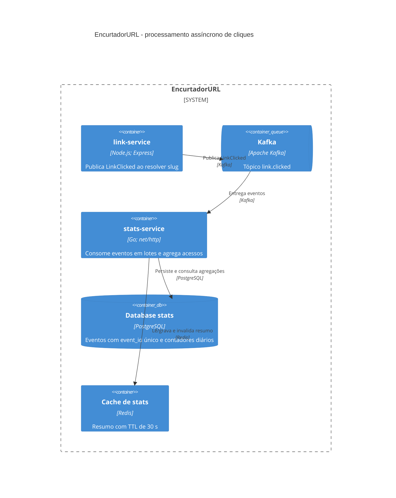

# Visão geral do EncurtadorURL

## O que é

O EncurtadorURL é um projeto de encurtador de URLs com estatísticas de acesso, desenvolvido para a disciplina de Arquitetura de Software Multiplataforma. A proposta separa a API pública, o gerenciamento e a resolução de links e o processamento de estatísticas em componentes independentes.

## Arquitetura implementada

### C4: contexto



### C4: containers - acesso e API



### C4: containers - persistência de links



### C4: containers - pipeline de eventos



No diagrama de contexto, Keycloak aparece como provedor externo à lógica de negócio. No Compose local, ele também é executado como container. PostgreSQL é uma única instância; `links` e `stats` são databases lógicos separados, não bancos distribuídos.

As três vistas de containers estão separadas por fluxo (acesso/API, persistência de links e eventos) para que relações e rótulos não se sobreponham. O login e a validação de token com Keycloak são detalhados no contexto e na sequência OIDC abaixo.

O Vite participa do build da SPA; no runtime, o container `frontend` usa Nginx para servir os arquivos estáticos e encaminhar chamadas ao BFF. O navegador não acessa diretamente os serviços internos.

O navegador fala com o Nginx do frontend. O Nginx encaminha `/api/**` e `/r/**` ao BFF, mantendo uma única origem para o browser e ocultando os endereços dos serviços internos. O BFF valida JWT, encaminha operações ao `link-service` preservando o bearer token e consulta o `stats-service` após confirmar a propriedade do link.

Os componentes têm dependências e imagens independentes e não devem importar código uns dos outros. A comunicação entre componentes é feita pelos contratos HTTP e pelo evento Kafka.

## Estado real da implementação

O fluxo principal está implementado e executável no Compose:

- **Frontend:** Vue 3 + Vite, `keycloak-js` com Authorization Code/PKCE, token em memória e cliente HTTP para o BFF. Nginx serve a SPA e encaminha `/api`, `/r` e `/health`.
- **BFF:** protege `/api/**`, valida assinatura, emissor e expiração do JWT; cria, lista e exclui links, consulta estatísticas e redireciona slugs.
- **link-service:** valida o mesmo JWT, usa `sub` como proprietário, persiste links no PostgreSQL, usa Redis para cache e publica `LinkClicked` após resolução.
- **stats-service:** a implementação Go existente foi preservada; consome Kafka em lotes, deduplica eventos por `event_id`, grava cliques e contadores diários atomicamente no PostgreSQL e responde totais/série diária; Redis guarda o resumo versionado por 30 segundos.
- **PostgreSQL:** uma instância hospeda os bancos lógicos `links` e `stats`. Os serviços inicializam suas tabelas idempotentemente; Go migra o histórico legado e cria agregados sem apagar volumes. Não há container `postgres-migrate` nesta integração.
- **Keycloak:** importa realm com clients separados para frontend (OIDC/PKCE) e Postman (somente demonstração/testes).
- **Logs locais:** o perfil Compose opcional `observability` executa Grafana, Loki e Alloy. O Alloy lê os logs dos containers deste projeto pelo socket Docker, o Loki os retém por sete dias e o Grafana tem uma fonte Loki provisionada. Apenas o Grafana é publicado no host, em loopback; a configuração é destinada a desenvolvimento local.
- **Testes:** os targets Docker executam lint/testes/build com Node e Go dentro de containers. O CI mantém verificações nativas, race detector e testes de integração PostgreSQL/Redis/Kafka, além do frontend e smoke test através do Nginx.
- **Observabilidade distribuída:** o serviço Go tem suporte opcional a OpenTelemetry, mas o Compose não inclui um coletor OTLP nem backend de traces/métricas. Grafana/Loki/Alloy centralizam logs; não substituem essa instrumentação.

O ambiente usa configurações de demonstração e um único broker Kafka/PostgreSQL; não representa uma implantação de alta disponibilidade para produção.

## Organização do repositório

| Caminho | Responsabilidade |
|---|---|
| `frontend/` | SPA Vue, client OIDC e Nginx como proxy para o BFF |
| `bff/` | API de entrada, encaminhamento e agregação para clientes |
| `link-service/` | Domínio de links e resolução de slugs |
| `stats-service/` | Ingestão de eventos e consultas de estatísticas |
| `infra/postgres/` | Inicialização dos bancos e usuários PostgreSQL |
| `infra/kafka/` | Criação dos tópicos locais |
| `infra/keycloak/` | Importação do realm de autenticação |
| `docs/contratos.md` | Contratos HTTP, evento, cache, autenticação, portas e ambiente |
| `docker-compose*.yml` | Runtime integrado, testes containerizados, exposição local de desenvolvimento e perfil de imagens de produção |
| `.github/workflows/ci.yml` | Qualidade, smoke test e publicação de imagens |

Cada serviço tem seu próprio `Dockerfile`. Os serviços Node usam ES modules e scripts npm; o serviço Go usa `net/http`, `go vet` e `go test -race`. A integração preserva as implementações de BFF, links e estatísticas já presentes no novo repositório, sem restaurar o serviço Python antigo. Consulte [stats-go.md](./stats-go.md) para detalhes de migração e cache versionado.

## Fluxo ponta a ponta

1. A SPA redireciona o usuário ao Keycloak usando Authorization Code com PKCE; o token é mantido em memória no browser.
2. O browser chama `/api/**` na origem do frontend. O Nginx encaminha a chamada ao BFF, que valida o JWT.
3. Para criar/listar/excluir links, o BFF repassa o bearer token ao `link-service`; a claim `sub` define e limita o proprietário no PostgreSQL.
4. Ao abrir `/{slug}` via `/r/{slug}`, Nginx e BFF encaminham a resolução pública ao `link-service`, que consulta Redis/PostgreSQL e publica `LinkClicked` no Kafka.
5. O `stats-service` grava o evento no banco `stats` usando `event_id` único; o BFF agrega totais e a SPA consulta detalhes pela API pública.

Para a sequência completa de mensagens e as justificativas das tecnologias, consulte [decisões arquiteturais](./decisoes-arquiteturais.md).
Para a apresentação do projeto, consulte o [roteiro de 20 minutos para sete integrantes](./roteiro-apresentacao.md).

## Contratos importantes

Antes de adicionar ou alterar endpoints, eventos, autenticação, cache, portas ou variáveis de ambiente, consulte [docs/contratos.md](./contratos.md). Ele define, entre outros:

- JSON em `camelCase`, datas UTC em ISO 8601, IDs UUID e slugs de sete caracteres alfanuméricos;
- formato padronizado de erros e códigos HTTP;
- separação entre rotas públicas e autenticadas;
- formatos das APIs pública e internas;
- payload e entrega pelo menos uma vez do evento Kafka `LinkClicked`;
- chaves e TTLs dos caches Redis.

Mudanças que afetem consumidores devem atualizar o contrato e os pontos de integração no mesmo conjunto de alterações.

## Desenvolvimento e verificação

Para iniciar o ambiente integrado, na raiz:

```bash
docker compose up -d --build --wait
```

Para rodar todos os testes sem instalar runtimes ou dependências na máquina, use os containers de teste:

```bash
docker compose -f docker-compose.test.yml build
docker compose -f docker-compose.test.yml run --rm test-frontend
docker compose -f docker-compose.test.yml run --rm test-bff
docker compose -f docker-compose.test.yml run --rm test-link-service
docker compose -f docker-compose.test.yml run --rm test-stats-service
```

O CI também constrói as imagens de runtime e executa um smoke test do stack completo. O fluxo e o acesso ao frontend estão no [README](../README.md).
